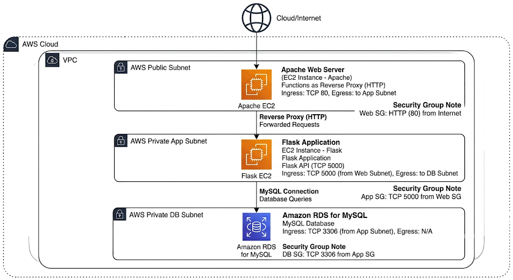
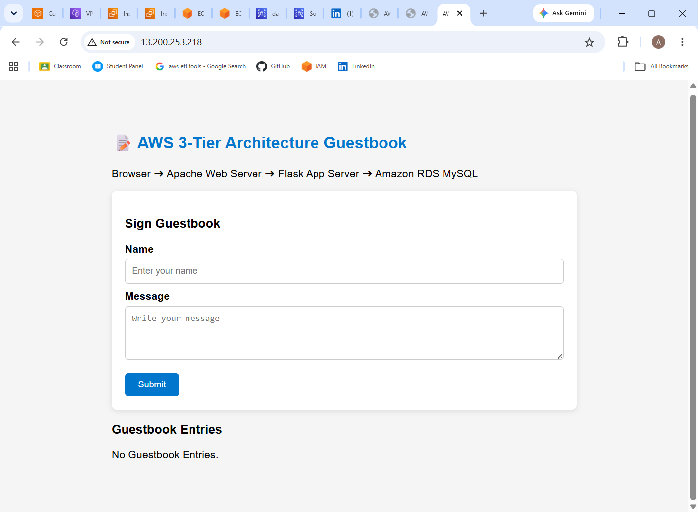
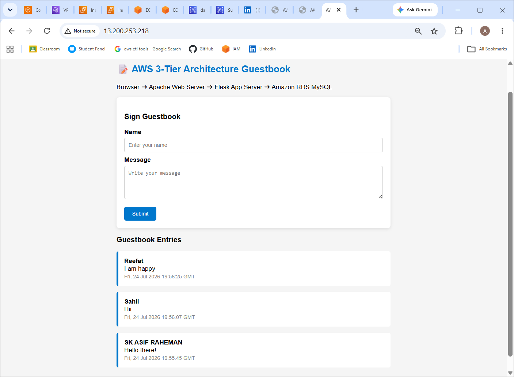
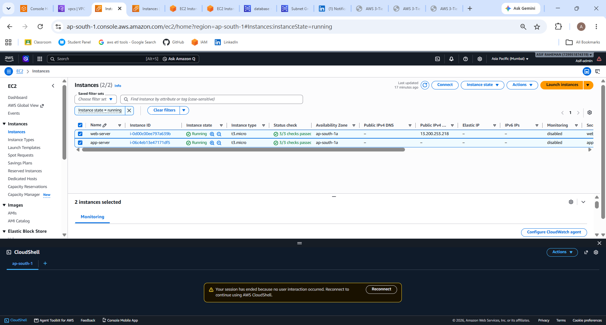
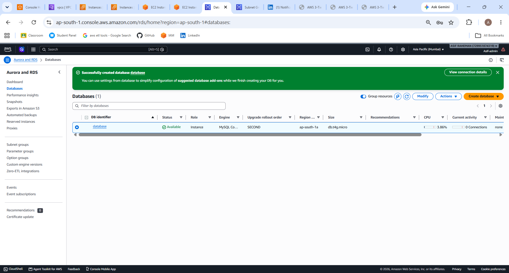
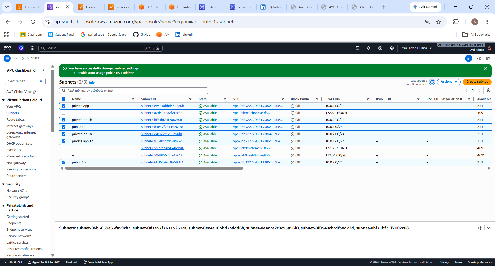
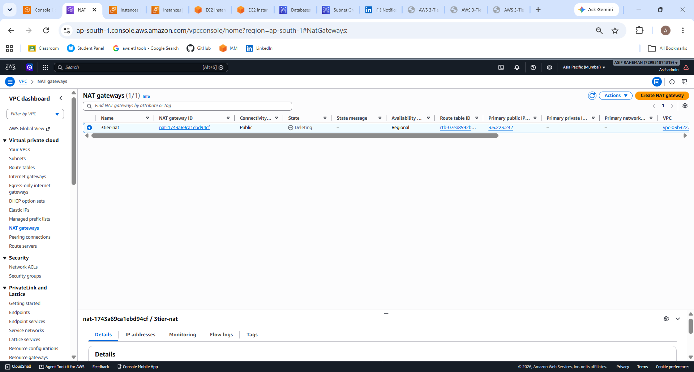
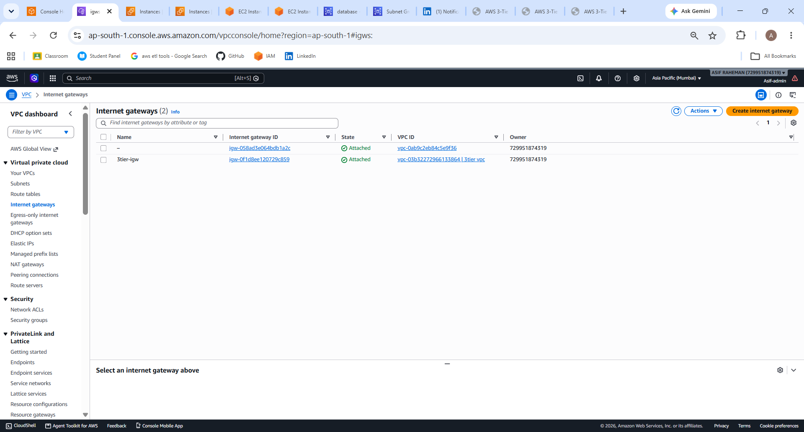
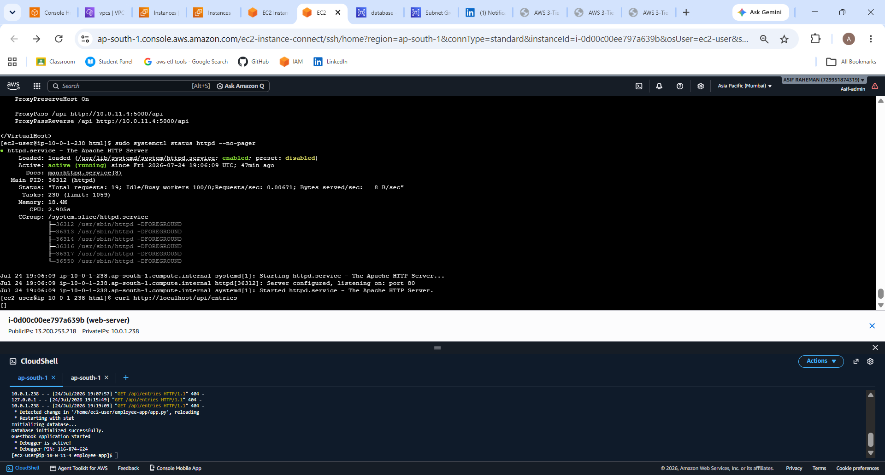
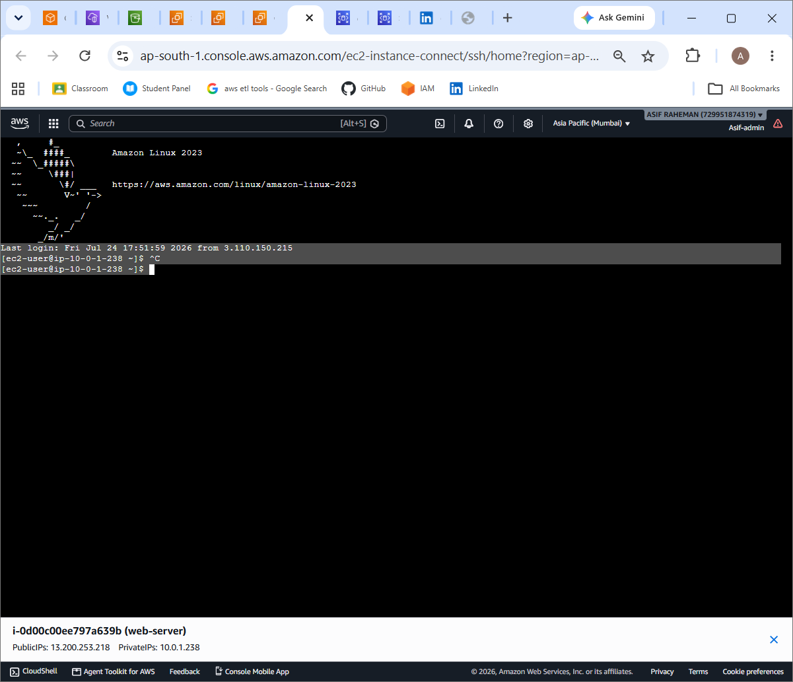

# 🚀 AWS 3-Tier Guestbook Application

A production-inspired 3-tier web application deployed on Amazon Web Services (AWS) using Apache, Flask, and Amazon RDS MySQL, demonstrating secure network isolation, reverse proxy configuration, and multi-tier application architecture.


## Architecture




## Project Overview

This application follows a classic three-tier architecture:

- **Presentation Tier**
  - Apache Web Server
  - Serves the frontend
  - Reverse Proxy to backend API

- **Application Tier**
  - Python Flask REST API
  - Processes guestbook requests
  - Communicates with Amazon RDS

- **Database Tier**
  - Amazon RDS MySQL
  - Stores guestbook entries securely
  - Accessible only from the Application Tier

---

## Architecture Components

### Networking

- Amazon VPC
- 2 Availability Zones
- Public Subnets
- Private Application Subnets
- Private Database Subnets
- Internet Gateway
- Route Tables

### Security

- Security Groups
- Network Isolation
- Reverse Proxy using Apache
- Private Application Server
- Private Database Server

### Compute

- Amazon EC2 (Web Server)
- Amazon EC2 (Application Server)

### Database

- Amazon RDS MySQL

---

## Technology Stack

| Category | Technologies |
|----------|--------------|
| Cloud | AWS |
| Compute | Amazon EC2 |
| Database | Amazon RDS MySQL |
| Networking | Amazon VPC, Subnets, Route Tables |
| Security | Security Groups |
| Backend | Python, Flask |
| Frontend | HTML, CSS, JavaScript |
| Web Server | Apache HTTP Server |
| Reverse Proxy | Apache ProxyPass |

---

## Project Structure

```
aws-3tier-network-isolation-app/
│
├── 📐 architecture/
│   ├── architecture.drawio          # AWS architecture source
│   └── architecture.png             # Architecture diagram
│
├── 🌐 frontend/
│   └── index.html                   # Guestbook web interface
│
├── ⚙️ backend/
│   ├── app.py                       # Flask REST API
│   └── requirements.txt             # Python dependencies
│
├── 📸 screenshots/
│   ├── homepage.png
│   ├── guestbook-entry.png
│   ├── ec2-instances.png
│   ├── rds.png
│   ├── vpc.png
│   └── security-groups.png
│
├── 📄 README.md
├── 📜 LICENSE
└── 🚫 .gitignore
```

---

## Deployment Flow

```
User
   │
   ▼
Apache Web Server (Public EC2)
   │
   ▼
Flask Application (Private EC2)
   │
   ▼
Amazon RDS MySQL (Private Subnet)
```

AWS Infrastructure

├── 🌍 Amazon VPC
├── 🌐 Public Subnet
│   └── Amazon EC2 (Apache Web Server)
│
├── 🔒 Private Application Subnet
│   └── Amazon EC2 (Flask API)
│
├── 🗄️ Private Database Subnet
│   └── Amazon RDS MySQL
│
└── 🛡️ Security Groups

---

## Features

- Responsive Guestbook UI
- REST API using Flask
- Apache Reverse Proxy
- Secure 3-Tier AWS Architecture
- Private Backend Server
- Private Amazon RDS Database
- Database Initialization
- Guest Entry Storage
- View Existing Entries

---

## API Endpoints

### Get All Entries

```
GET /api/entries
```

### Add New Entry

```
POST /api/entries
```

Request Body

```json
{
  "name": "Asif",
  "message": "Hello AWS!"
}
```

---

## Screenshots

### Architecture


### Guestbook Home





### Guestbook Entry




### AWS EC2 Instances





### Amazon RDS





### VPC Architecture





### NAT Gateway




### Internet gateway




### web server ssh


### app server ssh




## Learning Outcomes

- Designed a secure 3-tier AWS architecture
- Configured VPC networking and subnet isolation
- Deployed Apache as a reverse proxy
- Developed a Flask REST API
- Connected Flask with Amazon RDS MySQL
- Implemented secure communication between application layers
- Troubleshot Apache proxy and backend connectivity issues

---

## Future Enhancements

- HTTPS using AWS Certificate Manager
- Application Load Balancer
- Auto Scaling Groups
- Amazon Route 53
- AWS WAF
- CI/CD using GitHub Actions
- Docker Deployment
- Infrastructure as Code using Terraform

---

## Author

**SK Asif Raheman**

- LinkedIn: https://linkedin.com/in/sk-asif-raheman-09a250294
- GitHub: https://github.com/asifraheman2002

---

## License

This project is licensed under the MIT License.