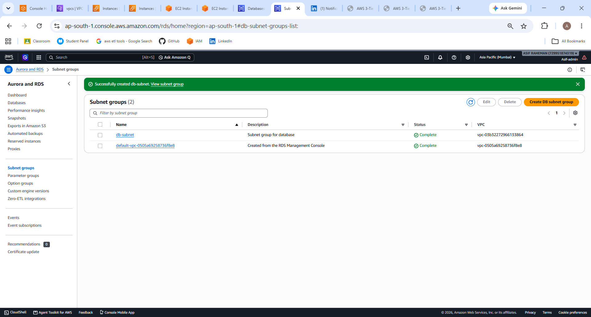
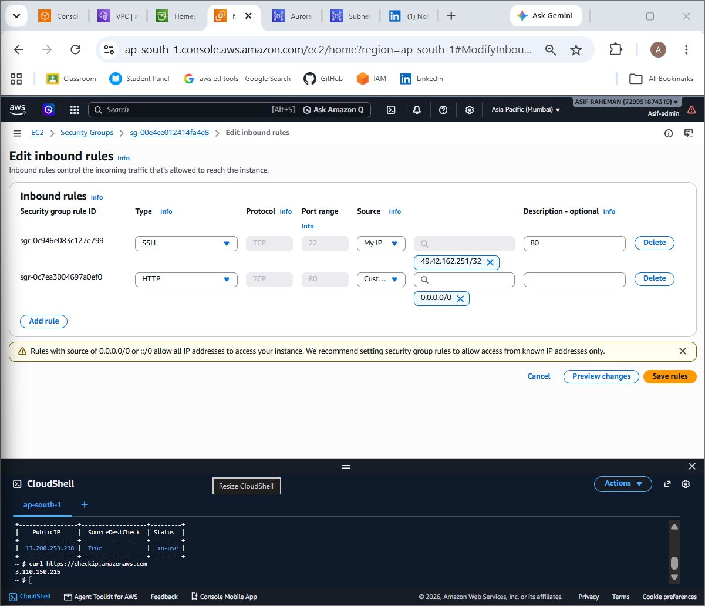

# AWS 3-Tier Guestbook Application

**A cloud-hosted web application demonstrating multi-tier architecture, network segmentation, reverse proxy integration, and managed database connectivity on Amazon Web Services.**

This project implements a three-tier application using Apache HTTP Server, Python Flask, and Amazon RDS for MySQL. The infrastructure separates the public-facing web layer from the private application and database layers using Amazon VPC networking.

The primary engineering focus was understanding how independently deployed components communicate, how access is controlled between application tiers, and how to diagnose failures across the infrastructure and application stack.

## Architecture


### System Design

| Layer | Implementation | Responsibility |
|---|---|---|
| Presentation | Apache HTTP Server on Amazon EC2 | Serves the frontend and forwards API requests |
| Application | Python Flask on Amazon EC2 | Handles guestbook operations and application logic |
| Data | Amazon RDS for MySQL | Persists guestbook entries |

### Request Lifecycle

A browser request enters through the public web tier. Apache serves the frontend and reverse-proxies API requests to the Flask application using its private network address. Flask processes the request and communicates with RDS when database operations are required. The response is returned through Apache to the browser.

```text
                         CLIENT
                           |
                           | HTTP
                           v
                +----------------------+
                |    WEB TIER          |
                |    Amazon EC2        |
                |    Apache HTTP       |
                |    Public Subnet     |
                +----------------------+
                           |
                           | Reverse Proxy
                           | TCP 5000
                           v
                +----------------------+
                |  APPLICATION TIER    |
                |    Amazon EC2        |
                |    Python Flask      |
                |    Private Subnet    |
                +----------------------+
                           |
                           | MySQL
                           | TCP 3306
                           v
                +----------------------+
                |    DATABASE TIER     |
                |    Amazon RDS        |
                |    MySQL             |
                |    Private Subnet    |
                +----------------------+
```

## Infrastructure Design

The application runs inside an Amazon VPC with network responsibilities separated by tier.

| Component | Role in the architecture |
|---|---|
| Amazon VPC | Provides the isolated network environment |
| Public subnet | Hosts the internet-facing web server |
| Private application subnet | Hosts the Flask application |
| Private database subnet | Hosts the MySQL database |
| Internet Gateway | Provides internet routing for the public subnet |
| NAT Gateway | Supports outbound internet connectivity from private subnet resources when required |
| Route Tables | Control traffic routing between network destinations |
| Security Groups | Define permitted network communication |

### Network Access Model

The intended communication boundaries are:

| Source | Destination | Port | Purpose |
|---|---|---:|---|
| Client | Web Server | 80 | HTTP application access |
| Web Server | Application Server | 5000 | Backend API communication |
| Application Server | RDS | 3306 | MySQL database access |
| Administrator | EC2 | 22 | Restricted SSH administration |

The design avoids requiring direct public access to the Flask application or the database. The web tier acts as the application entry point, while the backend tiers communicate through private network addresses.

## Technology Stack

| Area | Technologies |
|---|---|
| Cloud Platform | Amazon Web Services |
| Compute | Amazon EC2 |
| Networking | Amazon VPC, Subnets, Route Tables |
| Connectivity | Internet Gateway, NAT Gateway |
| Network Access Control | AWS Security Groups |
| Web Server | Apache HTTP Server |
| Reverse Proxy | Apache mod_proxy, mod_proxy_http |
| Backend | Python, Flask |
| API | REST |
| Data Exchange | JSON |
| Database | Amazon RDS for MySQL |
| Frontend | HTML, CSS, JavaScript |
| Version Control | Git, GitHub |
| Architecture Design | diagrams.net |

## Application Implementation

The application provides a guestbook interface backed by a Flask REST API and a MySQL database.

### Implemented API

| Method | Endpoint | Function |
|---|---|---|
| GET | `/api/entries` | Retrieves guestbook entries |
| POST | `/api/entries` | Submits a new guestbook entry |

Example GET response when the guestbook contains no entries:

```json
[]
```

Example POST request payload:

```json
{
  "name": "Asif",
  "message": "Hello AWS!"
}
```

The API is exposed to the browser through the Apache reverse proxy rather than requiring direct browser access to the private Flask server.

### Apache Reverse Proxy

Apache forwards requests under `/api` to the Flask application.

Configuration file:

`/etc/httpd/conf.d/app.conf`

```apache
<VirtualHost *:80>

    ProxyPreserveHost On

    ProxyPass /api http://APP_SERVER_PRIVATE_IP:5000/api
    ProxyPassReverse /api http://APP_SERVER_PRIVATE_IP:5000/api

</VirtualHost>
```

`APP_SERVER_PRIVATE_IP` represents the private address of the application EC2 instance.

The proxy configuration separates the public HTTP entry point from the backend application endpoint.

## Repository Structure

```text
aws-3tier-network-isolation-app/
│
├── architecture/
│   ├── architecture.drawio
│   └── architecture.png
│
├── backend/
│   ├── app.py
│   └── requirements.txt
│
├── frontend/
│   └── index.html
│
├── screenshots/
│   ├── appserver.png
│   ├── dbsubnet.png
│   ├── ec2.png
│   ├── guestbook-entry.png
│   ├── homepage.png
│   ├── igw-3tier.png
│   ├── nat-gateway-3tier.png
│   ├── rds.png
│   ├── security-groups.png
│   ├── vpc-subnets-.png
│   └── webserver.png
│
├── .gitignore
├── LICENSE
└── README.md
```

## Implementation Evidence

The following screenshots document the application and AWS infrastructure used in the project.

### Application

**Guestbook homepage**

The user-facing application interface, demonstrating the presentation layer delivered through the web server.


**Guestbook entries**

The guestbook interface displaying submitted entry data.


### Compute and Application Infrastructure

**EC2 instances**

The compute layer used to separate the web server from the application server.


**Web server**

Terminal evidence of access to the web tier, where Apache configuration and proxy testing were performed.


**Application server**

Terminal evidence of access to the application tier, where the Flask service and API were managed and tested.


### Network Architecture

**VPC and subnet design**

Shows the network segmentation used to separate public-facing, application, and database resources.


**Database subnet**

Documents the database network segment.



**Internet Gateway**

Shows the VPC component responsible for internet routing to the public network tier.


**NAT Gateway**

Documents the NAT Gateway component of the private subnet routing design.


### Database and Security

**Amazon RDS**

The managed MySQL database used by the application for guestbook data storage.


**Security Groups**

Documents the network access-control configuration associated with the AWS infrastructure.



## Engineering Challenges and Troubleshooting

The implementation involved troubleshooting issues across the frontend, backend, and web-server integration.

### 1. Missing Flask API Routes

**Observed issue:** API requests did not return the expected JSON response.

**Investigation:** the Flask application was inspected using route-decorator searches. The required GET and POST route definitions were initially missing.

**Resolution:** added the `/api/entries` GET and POST routes and the root route.

**Engineering takeaway:** a running web application does not guarantee that the requested endpoint is registered. Route availability must be verified independently.

### 2. Frontend JSON Parsing Failure

**Observed error:**

```text
SyntaxError: Unexpected token '<'
```

**Diagnosis:** the frontend expected JSON but received an HTML error response. The HTML response was being passed to JSON parsing logic.

**Resolution:** corrected the missing API routes and verified the endpoint response.

**Engineering takeaway:** inspect the actual HTTP response and status code before assuming a JSON parsing problem originates in frontend code.

### 3. Apache 503 Service Unavailable

**Observed issue:** requests through Apache to `/api/entries` returned HTTP 503.

**Investigation:** checked whether a process was listening on TCP port 5000:

```bash
sudo ss -tlnp | grep 5000
```

No listening process was shown at that time.

**Root cause:** the Flask backend was not running or listening when Apache attempted to forward the request.

**Resolution:** restarted the Flask application. Database initialization succeeded, and Flask started listening on `0.0.0.0:5000`. The Apache proxy endpoint subsequently returned the expected JSON response:

```json
[]
```

**Engineering takeaway:** a reverse proxy depends on backend availability. Verify the upstream process, listening port, and network connectivity before changing a working proxy configuration.

### Validation Approach

The application was tested at separate communication boundaries:

| Validation point | Test | Purpose |
|---|---|---|
| Application server | `curl http://localhost:5000/api/entries` | Verify Flask and the local API |
| Web-to-application connection | `curl http://APP_SERVER_PRIVATE_IP:5000/api/entries` | Verify private network communication |
| Apache reverse proxy | `curl http://localhost/api/entries` | Verify proxy-to-backend integration |
| Browser | Open the guestbook application | Verify the end-to-end user experience |

This layered approach helped distinguish application failures from network and reverse-proxy failures.

## Security and Operational Considerations

The architecture follows a tier-based network access model:

- Public HTTP access is directed to the web tier.
- The application tier is intended to receive traffic from the web tier.
- The database tier is intended to accept MySQL connections from the application tier.
- SSH administration should be restricted to trusted sources.
- Database credentials and private keys should remain outside public source control.

The design applies the principle of least privilege by limiting communication to the connections required by each tier.

## Engineering Outcomes

This project provided practical experience in:

**Cloud infrastructure**
- Deploying compute and database resources on AWS.
- Working with VPCs, subnets, route tables, and internet connectivity.
- Separating public and private application components.

**Application integration**
- Deploying Apache and Flask on separate EC2 instances.
- Configuring reverse proxy routing.
- Connecting application logic with Amazon RDS MySQL.
- Working with REST endpoints and JSON responses.

**Troubleshooting**
- Identifying missing backend routes.
- Diagnosing unexpected HTML responses from API requests.
- Investigating an Apache 503 through backend process and port checks.
- Validating connectivity between individual architecture layers.

## Current Scope and Limitations

This repository documents a working learning and portfolio implementation of a three-tier application. It should not be interpreted as a complete enterprise production deployment.

The following capabilities are potential improvements and are not presented as implemented features:

- HTTPS and certificate management.
- Application Load Balancer.
- EC2 Auto Scaling.
- Multi-AZ database deployment.
- Automated infrastructure provisioning.
- CI/CD pipeline.
- Centralized monitoring and alerting.
- Persistent production process management for the Flask service.

## Future Engineering Roadmap

| Priority | Enhancement | Engineering value |
|---|---|---|
| 1 | Persistent Flask service using systemd and a production WSGI server | Reliable application process management |
| 2 | HTTPS using AWS Certificate Manager | Encrypted client communication |
| 3 | Amazon CloudWatch logs, metrics, and alarms | Operational visibility |
| 4 | Terraform infrastructure as code | Repeatable and version-controlled infrastructure |
| 5 | GitHub Actions CI/CD | Automated testing and deployment |
| 6 | Application Load Balancer and Auto Scaling | Improved traffic handling and application scalability |
| 7 | RDS Multi-AZ | Improved database availability |
| 8 | AWS Secrets Manager | Centralized credential management |
| 9 | Docker and Amazon ECS | Containerized application deployment |
| 10 | Route 53 and AWS WAF | DNS management and additional web protection |

## Author

**SK ASIF RAHEMAN**

MCA Student | Aspiring Cloud / AWS Engineer

- GitHub: [asifraheman2002](https://github.com/asifraheman2002)
- LinkedIn: [SK Asif Raheman](https://www.linkedin.com/in/sk-asif-raheman/)

## License

Distributed under the MIT License. See [LICENSE](LICENSE) for details.
